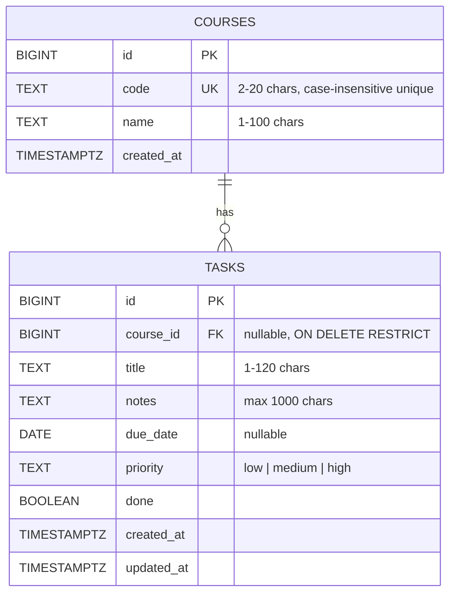

# Database schema

Supabase (PostgreSQL), two tables, one-to-many: a course has many tasks; a
task belongs to zero or one course. Full DDL is in `../supabase/schema.sql`
(SQLite equivalent in `../schema.sql`). Supabase also holds two views
(`task_details`, `course_summary`), two functions (`list_tasks`,
`task_stats`) and a trigger that keeps `tasks.updated_at` current.

Indexes: `tasks(course_id)`, `tasks(due_date)`, `tasks(done)`.

## API

| Method | Path | Does |
|---|---|---|
| GET | /api/tasks?status=&course=&q=&sort= | List tasks (status: all/open/done/overdue; course: id or `none`; sort: due/priority/newest) |
| GET | /api/tasks/:id | One task |
| POST | /api/tasks | Create a task |
| PUT | /api/tasks/:id | Update any subset of fields |
| DELETE | /api/tasks/:id | Delete a task |
| DELETE | /api/tasks?done=true | Delete all completed tasks |
| GET | /api/courses | List courses with task counts |
| POST | /api/courses | Create a course |
| PUT | /api/courses/:id | Update a course |
| DELETE | /api/courses/:id | Delete a course (409 if it still has tasks) |
| GET | /api/stats | Totals: open, done, overdue |
